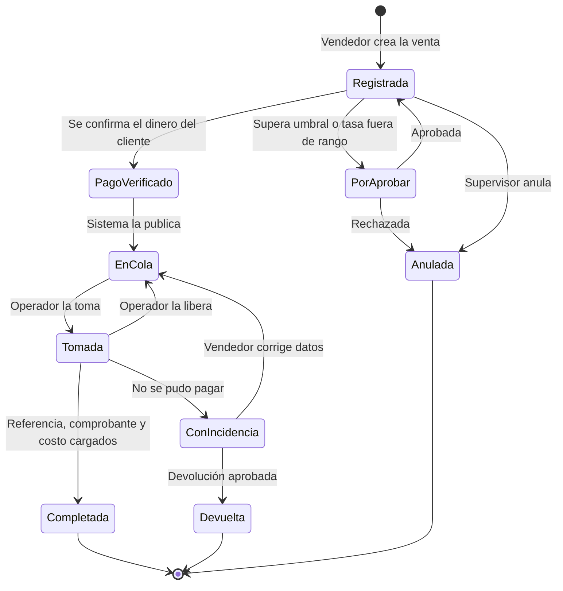
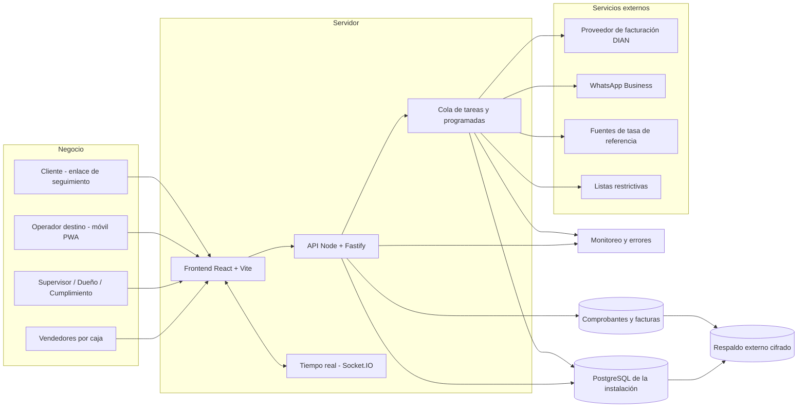
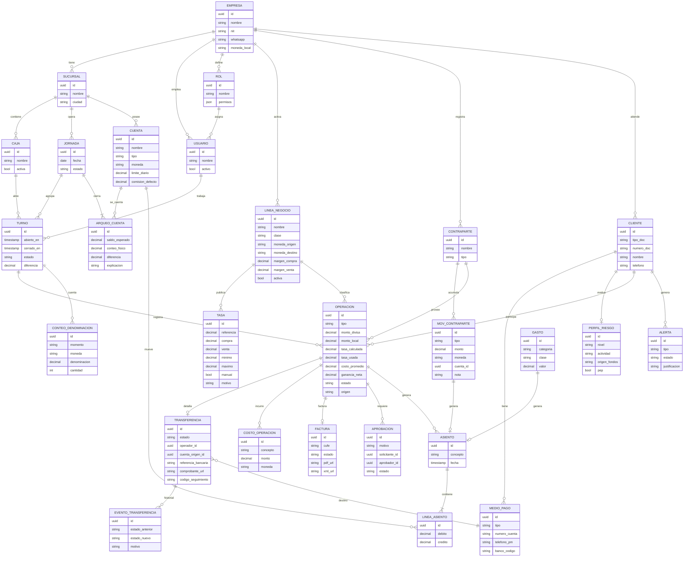

# Cambios JC — Sistema de operación y contabilidad para casas de cambio

> Especificación **v3.5** · Reemplaza el enfoque de DivSoft (React + localStorage)
> Objetivo: **uso real en Cambios JC**; instalable para **algunos negocios similares** que lo soliciten (no es un producto de venta masiva)
> Stack: **React + Node + PostgreSQL**

### Historial del documento
| Versión | Cambios |
|---|---|
| v1 | Primera especificación: roles, remesas con operador en Venezuela, caja, arquitectura |
| v2 | Multiempresa, contrapartes como cuentas corrientes, tasas con margen, arqueo en dos partes |
| v3 | Comparación con el mercado; se agregan facturación DIAN, sucursales/cajas/turnos, arqueo por denominación, módulo SARLAFT, liquidez, costos por transferencia, tasa asistida, seguimiento al cliente, doble control, permisos configurables, requisitos no funcionales y entregas por versión |
| **v3.1** | Respuestas de operación del local: recibo en ticket térmico, facturación electrónica opcional por empresa (desactivada en Cambios JC), el operador en Venezuela se llama **digitador**, cumplimiento pendiente de definir con el contador |
| **v3.2** | El sistema es propio y se instala por negocio: se reemplaza la plataforma multiempresa compartida por **una instalación independiente por cliente**; se simplifica el aislamiento (sin RLS) y la versión para terceros |
| **v3.3** | Se incorpora el software operativo actual de Cambios JC: roles **administrador, vendedor y digitador**; vista mínima del digitador; el sistema nuevo **reemplaza** ese software y migra su base de datos |
| **v3.4** | No hay acceso al código ni a la base del software actual (los tiene su desarrollador): la migración se plantea por exportación de datos, con alternativas si no se obtiene |
| **v3.5** | Se analizó la exportación real del programa actual: mapeo de campos y estados, cuentas venezolanas a nombre de terceros, validación automática del comprobante |

---

## 1. Visión

### 1.0 Punto de partida
Hoy Cambios JC trabaja con **dos herramientas separadas**:

| Herramienta | Qué cubre | Qué le falta |
|---|---|---|
| **Software operativo propio** | Registro de transferencias por roles (administrador, vendedor, digitador), base de datos de clientes y cuentas, carga del comprobante por el digitador | Contabilidad, caja, ganancia, contrapartes, dólares |
| **Excel `CAMBIOS JC-USB.xlsx`** | Contabilidad diaria: compras, ventas, ganancia, gastos, saldos, arqueo | Trazabilidad, precisión, trabajo multiusuario |

El sistema nuevo **unifica las dos** y reemplaza ambas. Conserva lo que ya funciona del software operativo (roles, flujo del digitador, datos de clientes) y le suma la parte contable.


Un sistema web propio de Cambios JC para reemplazar su Excel diario, diseñado para que pueda instalarse en otras casas de cambio que trabajan de la misma forma. Cambios JC es el caso de referencia: su libro `CAMBIOS JC-USB.xlsx` (174 hojas diarias, sep-2023 a jun-2026) define el vocabulario y las reglas.

- El **vendedor** registra cada operación una sola vez, en su caja y su turno.
- El **digitador en Venezuela** ve en tiempo real lo que debe pagar.
- La **ganancia, los saldos, las deudas, la liquidez y el cuadre de caja** se calculan solos.
- La **factura electrónica** y los **datos de cumplimiento** salen de la misma operación.
- Cada peso, bolívar y dólar tiene rastro: quién lo movió, cuándo y por qué.

### Problemas del Excel que el sistema debe eliminar

| Problema detectado | Evidencia en el Excel | Solución en el sistema |
|---|---|---|
| Faltantes/sobrantes sin explicación | 60 de 174 días con diferencia; ~7 M COP acumulados; `K89` digitada a mano | Arqueo por caja, turno y denominación + bitácora |
| Deudas mezcladas con el dinero disponible | Saldos de personas sumados en `J2` junto a caja y bancos | Contrapartes separadas del dinero disponible (§5.8) |
| Contrapartes sin control | > 30 nombres en 3 años, con errores y combinaciones ("ALFRAN-JHON CANO") | Catálogo con cuenta corriente propia |
| Signo de las deudas implícito | Negativo = nos debe; solo se sabe por costumbre | Pantalla con **Me debe** / **Le debo** |
| Promedio de compra mal calculado | `AVERAGEIF` sin ponderar, incluye filas en 0 | Costo promedio ponderado móvil (§7.3) |
| Costos bancarios como gasto general | "comisión BNC" entre los gastos del día | Costo asociado a cada transferencia (§5.5) |
| Totales pegados a mano | `J2` sin fórmula en 131 de 174 hojas | Totales siempre derivados |
| Fechas inválidas | Hojas `25-11-20248`, `18-02--20226` | La fecha la pone el servidor |
| Clientes duplicados | 1.474 nombres escritos libremente | Cliente identificado por tipo + número de documento |

---

## 2. Comparación con el mercado

Se revisaron sistemas comerciales para casas de cambio en Colombia y Latinoamérica (Divisafe, SistecPOS, Alice Solutions, NovoDivisas, entre otros).

### Lo que el mercado da por hecho
- Varias sucursales, cada una con su propio cierre de día; cajas y tasas por sucursal.
- Apertura y arqueo de caja **por usuario**.
- Facturación electrónica integrada (en Colombia, ante la DIAN).
- Datos estructurados para SARLAFT y reportes a la UIAF; ficha ampliada del cliente para montos altos.
- Trazabilidad de cada operación con autor, hora y movimiento contable.
- Actualización asistida o automática de tasas.
- El cumplimiento normativo se mantiene actualizado como parte del servicio, no como extra.

### Donde esta especificación supera al mercado
Los sistemas revisados están pensados para ventanilla (compra y venta de billetes). Ninguno resuelve bien las **remesas con operador en otro país**. Diferenciales:
- Cola del operador en Venezuela con bloqueo contra doble pago y comprobante obligatorio.
- Contrapartes como cuentas corrientes separadas del dinero disponible.
- Arqueo que distingue faltantes reales de deudas no registradas.
- Costo promedio ponderado móvil por divisa.
- Tablero de liquidez de bolívares frente a la cola pendiente.

### Evaluación
| Aspecto | v2 | v3 |
|---|---|---|
| Remesas y operador destino | Superior al mercado | Superior al mercado |
| Contrapartes y deudas | Superior al mercado | Superior al mercado |
| Divisas en caja | Al nivel | Al nivel |
| Cajas, turnos, denominaciones | Por debajo | Al nivel |
| Facturación electrónica | Ausente | Al nivel (opcional por empresa) |
| Cumplimiento SARLAFT/UIAF | Básico | Al nivel |
| Requisitos no funcionales | Ausentes | Definidos |
| **Nivel general** | **7 / 10** | **Profesional** |

### Lo que deliberadamente NO se construye
| Idea | Motivo |
|---|---|
| Que el cliente final envíe dinero desde una app o web | Convierte el producto en una fintech de pagos, con otra regulación y otro riesgo |
| Criptomonedas como línea de negocio | Fuera del negocio actual y con riesgo regulatorio alto |
| Contabilidad completa NIIF | Se exporta al software del contador (Siigo, Alegra, World Office) |
| Integración directa con bancos venezolanos | No hay API confiable; el comprobante manual es la solución realista |
| Modo sin conexión completo | Choca con el bloqueo contra doble pago y los saldos en tiempo real; se usa un plan de contingencia (§9.6) |
| Exportar a 7 formatos | Basta Excel, PDF e imprimir |

---

## 3. Glosario

| Término | Significado |
|---|---|
| **Empresa** | La casa de cambio dueña de una instalación del sistema. Cada instalación pertenece a una sola empresa |
| **Sucursal** | Un local físico de la empresa, con su propio cierre de día |
| **Caja** | Un puesto de atención dentro de una sucursal (efectivo y medios asociados) |
| **Turno** | Periodo en que un vendedor opera una caja: se abre con conteo y se cierra con arqueo |
| **Línea de negocio** | Tipo de negocio activado: **remesa** o **divisas en caja** |
| **Vendedor** | Persona en el local que atiende al cliente, registra operaciones y maneja una caja (en otros sistemas: cajero) |
| **Digitador** | Nombre que usa Cambios JC para el operador en Venezuela que monta las transferencias desde bancos venezolanos. En el sistema, rol **Digitador (operador destino)** |
| **Recibo** | Comprobante impreso en ticket que se entrega al cliente en cada operación. No es factura electrónica |
| **Remesa** | Envío de dinero a otro país; el cliente paga en moneda local y un operador paga en destino (ej. COP → VES) |
| **Divisas en caja** | Compra y venta de moneda extranjera en el local (ej. USD ↔ COP) |
| **Tasa de referencia** | Valor base del día por línea de negocio |
| **Margen** | Porcentaje aplicado a la referencia para obtener tasa de compra o venta |
| **Punto** | Tasa en moneda local por unidad extranjera. En Cambios JC: `pesos = bolívares × punto` |
| **Contraparte** | Persona o negocio con el que se lleva un saldo: préstamos, anticipos, compras a crédito, proveedores de bolívares |
| **Cuenta corriente** | Historial de movimientos con una contraparte y su saldo: **me debe** o **le debo** |
| **Dinero disponible** | Lo que se puede contar: caja física, bancos, billeteras |
| **Liquidez** | Moneda destino disponible frente a lo que está pendiente de pagar |
| **Denominación** | Valor de un billete o moneda (100 USD, 50.000 COP…) |
| **Doble control** | Operación que requiere aprobación de una segunda persona |
| **Arqueo** | Comparación entre el saldo esperado y el conteo físico |
| **Jornada** | Un día de operación de una sucursal |

---

## 4. Modelo de instalación, sucursales y cajas

### 4.1 Jerarquía
```
Empresa → Sucursal → Caja → Turno (vendedor)
```

### 4.2 Configurable por empresa
- Nombre, logo, NIT, WhatsApp (recibos y facturas).
- Monedas, denominaciones de billetes y monedas.
- Líneas de negocio activas con monedas y márgenes.
- Sucursales, cajas, cuentas, bancos, contrapartes, usuarios, categorías de gasto.
- **Roles y permisos** (§6).
- Umbrales de cumplimiento, de doble control y de liquidez.
- Proveedor de facturación electrónica.

### 4.3 Configuración de Cambios JC

| Línea de negocio | Clase | Monedas | Estado |
|---|---|---|---|
| Transferencias a Venezuela | Remesa | COP → VES | ✅ Activa |
| Dólares | Divisas en caja | USD ↔ COP | ✅ Activa |
| Bolívares en efectivo | Divisas en caja | VES ↔ COP | ⛔ Desactivada |

Una sucursal (Cúcuta), una o más cajas, varios operadores en Venezuela.

### 4.4 Una instalación por negocio
El sistema **no** es una plataforma compartida donde varios negocios guardan sus datos en el mismo servidor. Cada negocio tiene **su propia instalación**: su servidor (o su cuenta en la nube), su base de datos, sus respaldos.

| Aspecto | Plataforma compartida (descartada) | Instalación por negocio (elegida) |
|---|---|---|
| Datos de cada negocio | Todos en la misma base, separados por `empresa_id` + RLS | Cada negocio en su propia base |
| Riesgo de que un negocio vea datos de otro | Posible ante un error de código | No existe |
| Responsabilidad sobre los datos | El desarrollador custodia los datos de todos | Cada negocio custodia los suyos |
| Complejidad técnica | Alta (RLS, suscripciones, facturación del servicio) | Menor |
| Actualizaciones | Una sola vez para todos | Una por instalación (automatizable con Docker) |
| Adecuado para | Venta masiva | Pocos clientes conocidos |

- La configuración de la empresa (nombre, logo, líneas de negocio, monedas, márgenes…) vive en una tabla `configuracion`, no en el código: la misma versión del software sirve para cualquier negocio.
- Se mantiene `sucursal_id` en las tablas porque un negocio puede tener varios locales.

---

## 5. Módulos

### 5.1 Clientes
- **Identificación:** tipo (`V`, `E`, `J`, `G`, `P`; `CC`, `CE`, `PPT`, `PAS`, `NIT`; configurable) + número. Único por empresa + tipo + número.
- **Remitentes** (pagan en el local) y **beneficiarios** (reciben en destino). Una persona puede ser ambas.
- **Medios de pago del beneficiario:**
  - **Cuenta bancaria:** 20 dígitos, formato `XXXX XXXX XXXX XXXX XXXX`; los primeros 4 determinan el banco.
  - **Pago móvil:** código de banco + teléfono + documento del titular.
- Búsqueda rápida por documento.
- Ficha de cumplimiento ampliada (§5.13) cuando se superan los umbrales.

### 5.2 Tasas
1. El supervisor o dueño ingresa la **tasa de referencia** de cada línea (varias veces al día si hace falta).
2. **Tasa asistida:** al ingresarla, el sistema muestra como apoyo la tasa oficial (BCV) y una referencia de mercado configurable, con la hora de consulta. Son informativas: la decisión es humana.
3. El sistema calcula **tasa de compra** y **tasa de venta** con los márgenes.
4. **Cambio manual:**
   - Para el día: supervisor o dueño.
   - Para una operación: según permiso del rol; si se sale del rango permitido, pasa a **doble control** (§5.12).
   - Siempre con motivo y registro de tasa calculada vs usada.
5. Cada operación **congela** su tasa. Historial por línea con hora de vigencia.

### 5.3 Remesas — venta
1. Remitente (búsqueda por documento).
2. Beneficiario y medio de pago.
3. **Monto recibido** en moneda local.
4. **Tasa** vigente (editable según §5.2).
5. **Monto a enviar** calculado (`bolívares = pesos ÷ punto`), o a la inversa.
6. Cuenta por donde entró el dinero.
7. Comprobante del pago del cliente (opcional si es efectivo).
8. **Verificación de liquidez:** si los bolívares disponibles no alcanzan para la cola pendiente más esta operación, el sistema avisa antes de guardar (§5.10).
9. **Verificación de cumplimiento:** si el remitente o beneficiario supera un umbral, se exige la ficha ampliada o se genera alerta (§5.13).
10. Si el monto supera el umbral de doble control, queda pendiente de aprobación.

Al guardar se imprime el **recibo en ticket** (impresora térmica) y, solo si la empresa tiene activo el módulo, se emite la **factura electrónica** (§5.14).

**Contenido del recibo (formato actual de Cambios JC):**
logo del negocio · número de contacto / WhatsApp · N° de comprobante · identificación o cédula · titular de la cuenta · banco y código · número de cuenta o pago móvil · costo (pesos recibidos) · envío (bolívares) · fecha y hora · vendedor.

**Requisitos técnicos del recibo:**
- Impresión en térmica de 58 mm y 80 mm (comandos ESC/POS o impresión desde el navegador con plantilla de ticket).
- Plantilla configurable por empresa (logo, campos visibles, texto al pie).
- Número de comprobante consecutivo por empresa, sin saltos ni repetidos.
- Reimpresión marcada como **COPIA**.
- Versión digital del mismo recibo para compartir por WhatsApp (§5.15).

### 5.4 Remesas — vista del digitador (operador en Venezuela)
Se conserva la forma de trabajo del software actual. Vista móvil, liviana, tolerante a mala conexión.

**Principio de mínima información:** el digitador ve solo lo necesario para pagar. **Nunca** ve montos en pesos, tasa, ganancia, datos del remitente, saldos del negocio ni otras pantallas.

**Lo que ve de cada transferencia**
| Si el medio es cuenta bancaria | Si el medio es pago móvil |
|---|---|
| Titular de la cuenta | Titular |
| Banco | Banco |
| Número de cuenta (formato `XXXX XXXX XXXX XXXX XXXX`, con botón copiar) | Teléfono (botón copiar) |
| Cédula del titular | Cédula del titular |
| **Monto en bolívares** (botón copiar) | **Monto en bolívares** (botón copiar) |

**Lo que hace**
1. Ve la lista **En cola** por antigüedad y **toma** una (con bloqueo, para que dos digitadores no paguen la misma).
2. Paga desde el banco.
3. Sube la **captura del comprobante** (PNG/JPG; se comprime en el teléfono antes de enviarse).
4. Elige la **cuenta de origen** desde la que pagó (se propone la última usada: un toque).
5. Opcional pero recomendado: **referencia bancaria** (evita que un mismo comprobante se use dos veces) y **costo bancario** (se propone el de la cuenta).
6. → **Completada**. O **Reportar incidencia** con motivo.

> La cuenta de origen **ya se registra hoy** (campo "Mis Cuentas" del programa actual), así que no es un paso nuevo. Lo nuevo es la referencia y el costo, que quedan opcionales.

**Validación automática del comprobante (v1.5):** la captura del banco trae el monto, la referencia (número de operación) y los últimos 4 dígitos de las cuentas de origen y destino. El sistema lee la imagen (OCR) y:
- Propone la referencia sin que el digitador la escriba.
- Alerta si el monto de la captura no coincide con el monto a enviar.
- Alerta si los últimos 4 dígitos del destino no coinciden con la cuenta del beneficiario.
- Alerta si la referencia ya se usó en otra transferencia.
La validación ayuda, no bloquea: si la imagen no se lee bien, el digitador completa a mano.

- Notificación en tiempo real al vendedor.

### 5.5 Costos por operación
- Cada transferencia puede registrar su **costo bancario** (comisión del banco de origen, comisión de pago móvil…), en la moneda en que se cobró.
- Cada cuenta puede tener una **comisión por defecto** que se propone automáticamente.
- La ganancia de la operación es **neta de costos**.
- Los costos bancarios que no correspondan a una operación (cuota de manejo, etc.) siguen siendo gasto operativo.

### 5.6 Remesas — compra de moneda destino
- Contraparte, tasa de compra, bolívares recibidos, pesos calculados.
- Cuenta VES donde entraron.
- Forma de pago: **de contado** (sale de una cuenta COP) o **a crédito / con anticipo** (cuenta corriente de la contraparte).
- Alimenta inventario y costo promedio.

### 5.7 Divisas en caja
Por cada línea activa (Cambios JC: USD ↔ COP):
- **Compra** a tasa de compra y **venta** a tasa de venta.
- Registro de **denominaciones** recibidas y entregadas, que alimentan el conteo esperado de la caja.
- Inventario y costo promedio por divisa.
- Recibo en ticket por operación; factura electrónica si la empresa la activa.

### 5.8 Contrapartes y cuentas corrientes
**Contraparte:** nombre, documento (opcional), teléfono, tipo (proveedor de divisas, familiar, socio, tercero, otro), notas.

| Tipo de movimiento | Efecto |
|---|---|
| Préstamo que doy | Me debe más |
| Préstamo que recibo | Le debo más |
| Abono que me hace | Me debe menos |
| Abono que le hago | Le debo menos |
| Anticipo a proveedor | Me debe más (hasta que entregue la divisa) |
| Compra a crédito (divisas o para el local) | Le debo más |
| Ajuste | Corrección con motivo; requiere doble control |
| Otro | Con nota obligatoria |

- Cada movimiento indica si movió dinero físico (y de qué cuenta) o si es solo reconocimiento de deuda.
- Saldo por moneda (una contraparte puede deber en pesos y en bolívares a la vez).
- Resumen filtrable **Me deben** / **Les debo**; detalle con historial.
- Internamente: positivo = me debe, negativo = le debo. En pantalla solo etiquetas.

> Migración: en el Excel de Cambios JC, negativo = nos debe. Se invierte el signo.

### 5.9 Cuentas de dinero
> En Cambios JC, las cuentas venezolanas desde las que se paga suelen estar **a nombre de terceros** (ej. "VZLA SARA CASTRO"), que a su vez aparecen en el Excel como proveedores de bolívares. Por eso una cuenta puede asociarse a una **contraparte titular**: así se ve en un mismo lugar el saldo de la cuenta y la relación con esa persona.

- Catálogo: nombre, tipo (`caja`, `banco`, `billetera`), moneda, banco, últimos 4 dígitos, sucursal, **contraparte titular** (opcional), responsable, activa, límite diario, comisión por defecto.
- Saldo = suma de movimientos.
- Traslados y fondeos entre cuentas.
- Conciliación diaria de cuentas destino: el operador reporta el saldo real.

### 5.10 Liquidez
Tablero en tiempo real por moneda destino:
- **Disponible** en cuentas VES (por cuenta y total).
- **Comprometido:** remesas en cola o tomadas sin completar.
- **Libre** = disponible − comprometido.
- Compras en tránsito (anticipos a proveedores aún no entregados).
- Límites diarios restantes por cuenta.
- **Alertas** configurables: libre por debajo de un umbral, cuenta cerca de su límite, cola que crece más rápido que el fondeo.

### 5.11 Gastos
- Categoría, descripción, valor, cuenta, sucursal.
- **Gasto operativo** (resta a la ganancia) vs **retiro del dueño** (no resta a la ganancia).

### 5.12 Doble control (aprobaciones)
Operaciones que requieren una segunda persona, con umbrales configurables:
- Remesa o compra/venta de divisas por encima de un monto.
- Tasa manual fuera del rango permitido.
- Devoluciones y anulaciones.
- Ajustes en contrapartes o cuentas.
- Reapertura de un cierre.

Bandeja de aprobaciones para supervisor/dueño; quien solicita no puede aprobar su propia solicitud.

### 5.13 Cumplimiento (SARLAFT / UIAF)
- **Ficha ampliada del cliente:** actividad económica, origen de fondos, dirección, **marca PEP** (persona expuesta políticamente), documentos soporte.
- **Nivel de riesgo** del cliente (bajo / medio / alto), calculado con reglas configurables y ajustable manualmente con motivo.
- **Acumulados** por cliente y beneficiario (día, mes, año).
- **Alertas automáticas:** superación de umbrales, **fraccionamiento** (varias operaciones pequeñas del mismo remitente o hacia el mismo beneficiario), beneficiario que recibe de muchos remitentes, cliente en lista restrictiva.
- Consulta contra **listas restrictivas** (ONU, OFAC y las que defina la empresa).
- **Bandeja del oficial de cumplimiento:** revisar alerta, descartar con justificación o escalar.
- **Exportes** en el formato de reporte vigente de la UIAF.
- Umbrales y formatos **configurables por empresa** y revisados con el contador; cada empresa es responsable de sus reportes.

### 5.14 Facturación electrónica DIAN (módulo opcional)
> **Cambios JC:** desactivado. Hoy se entrega recibo en ticket y no se emite factura electrónica. El módulo existe porque otras empresas pueden necesitarlo o el negocio puede formalizarse más adelante.

- **No se construye un facturador propio:** integración por API con un proveedor tecnológico autorizado por la DIAN.
- Cada operación facturable genera la factura automáticamente al guardarse (o en lote al cierre, según lo que defina el contador).
- Se guarda CUFE, estado (enviada, aceptada, rechazada) y PDF/XML.
- Reintentos automáticos si el proveedor no responde; alerta si una factura queda rechazada.
- Notas crédito asociadas a devoluciones y anulaciones.
- Proveedor configurable por empresa.

### 5.15 Seguimiento al cliente
- Al guardar: envío del recibo por **WhatsApp** (inicialmente con enlace para compartir; luego con WhatsApp Business API).
- **Enlace de consulta** con código único: muestra estado (en cola / pagada / con incidencia) y, al completarse, el comprobante. Sin datos sensibles expuestos.
- Mensaje automático cuando la remesa se completa.

### 5.16 Caja: turnos y arqueo
**Apertura de turno**
- El vendedor abre su turno en una caja con **conteo por denominación**.
- Si el conteo no coincide con el cierre anterior de esa caja, se registra la diferencia.

**Durante el turno**
- Cada operación afecta el saldo esperado de su caja y sus denominaciones.
- Traslados entre cajas y hacia bóveda o banco.

**Cierre de turno**
1. **Conteo físico por denominación** para el efectivo; saldo reportado para bancos y billeteras.
2. Saldo esperado vs contado por cuenta → **SOBRANTE / FALTANTE / CUADRADO**, con explicación obligatoria si no cuadra.
3. El faltante o sobrante queda atribuido a **ese turno y ese vendedor**.

**Cierre de jornada (sucursal)**
- Requiere todos los turnos cerrados y ninguna remesa en estado *Tomada*.
- **A. Dinero disponible:** consolidado de cajas, bancos y billeteras.
- **B. Contrapartes:** me deben, le debo, movimientos del día.
- **C. Resumen:** ganancia neta por línea, devoluciones, gastos operativos, retiros del dueño, **posición total** = disponible + me deben − le debo − devoluciones pendientes.
- Si el módulo de facturación está activo: facturas pendientes o rechazadas visibles antes de cerrar.
- Cierre en solo lectura; reapertura con doble control.

### 5.17 Histórico y reportes
- Histórico por día / mes / año, por sucursal y caja.
- Búsqueda avanzada: comprobante, documento, nombre, usuario, banco, contraparte, fecha (`igual`, `mayor que`, `menor que`, `entre`).
- Reportes: ganancia neta por línea y periodo, costos bancarios, volumen por proveedor, top clientes, estado de contrapartes, diferencias de arqueo por vendedor, uso de tasas manuales, liquidez histórica, alertas de cumplimiento.
- **Tablero del dueño:** ganancia del día y del mes, liquidez, deudas, alertas abiertas.
- Exportar a **Excel** y **PDF**, e **imprimir**.
- Exportación contable para el software del contador.

### 5.18 Usuarios y auditoría
- Alta/baja de usuarios, asignación a sucursal/caja, rol, 2FA.
- Bitácora inmutable de todas las acciones (antes/después, IP, dispositivo).

---

## 6. Roles y permisos

### 6.1 Permisos configurables
Cada empresa parte de **roles predefinidos** y puede ajustarlos marcando permisos individuales (ej. `tasa.cambiar_en_operacion`, `contraparte.registrar_movimiento`, `caja.reabrir`). Los permisos críticos (reabrir cierres, aprobar lo propio) tienen restricciones que ningún rol puede saltarse.

### 6.2 Roles predefinidos
Los tres roles del software actual se conservan con el mismo nombre (**administrador, vendedor, digitador**). **Supervisor** y **oficial de cumplimiento** son opcionales: en un negocio pequeño el administrador cumple esas funciones.


| Acción | Vendedor | Digitador (VE) | Supervisor (opcional) | Cumplimiento (opcional) | Administrador / Dueño |
|---|:-:|:-:|:-:|:-:|:-:|
| Abrir/cerrar su turno | ✅ | ❌ | ✅ | ❌ | ✅ |
| Registrar clientes y beneficiarios | ✅ | ❌ | ✅ | ✅ | ✅ |
| Registrar remesa | ✅ | ❌ | ✅ | ❌ | ✅ |
| Verificar pago recibido | ✅ | ❌ | ✅ | ❌ | ✅ |
| Tomar y completar remesas | ❌ | ✅ | ❌ | ❌ | ❌ |
| Compra de divisa a contrapartes | ❌ | ❌ | ✅ | ❌ | ✅ |
| Compra/venta de divisas en caja | ✅ | ❌ | ✅ | ❌ | ✅ |
| Movimientos de contrapartes | ❌ | ❌ | ✅ | ❌ | ✅ |
| Registrar gastos | ✅ | ❌ | ✅ | ❌ | ✅ |
| Publicar tasa de referencia | ❌ | ❌ | ✅ | ❌ | ✅ |
| Cambio manual de tasa en operación | Configurable | ❌ | ✅ | ❌ | ✅ |
| Aprobar solicitudes de doble control | ❌ | ❌ | ✅ | ❌ | ✅ |
| Gestionar alertas de cumplimiento | ❌ | ❌ | ❌ | ✅ | ✅ |
| Cerrar jornada | ❌ | ❌ | ✅ | ❌ | ✅ |
| Configurar empresa, permisos, márgenes | ❌ | ❌ | ❌ | ❌ | ✅ |

**Soporte técnico:** quien instala y mantiene el sistema (el desarrollador) no tiene usuario dentro de la instalación de otro negocio; si necesita entrar para dar soporte, el dueño le crea un acceso temporal que queda en la bitácora.

**Reglas transversales**
- Nada se borra: se anula con motivo.
- Quien recibe el dinero no es quien lo paga.
- Nadie aprueba su propia solicitud.
- El digitador no modifica montos, tasa ni beneficiario.

---

## 7. Reglas de negocio y fórmulas

### 7.1 Tasas
```
tasa_compra = tasa_referencia * (1 - margen_compra)
tasa_venta  = tasa_referencia * (1 + margen_venta)

tasa manual del día       -> reemplaza la calculada
tasa manual en operación  -> reemplaza la del día (permiso + motivo)
fuera de [min, max]       -> doble control
```

### 7.2 Conversión (Cambios JC)
```
Remesa COP -> VES:  bolivares = pesos / punto
Divisas USD/COP:    pesos     = dolares * tasa
```

### 7.3 Costo y ganancia
El Excel promedia los puntos de compra sin ponderar (`AVERAGEIF`), incluye filas en 0 y reinicia cada día. Sobre las 174 hojas, la ganancia difiere en **≈ 5,5 M COP (~9 %)** frente al método ponderado.

```
Al comprar:
  costo_promedio = (inventario * costo_promedio + cantidad * tasa_compra)
                   / (inventario + cantidad)
Al vender:
  ganancia_bruta = (tasa_venta - costo_promedio) * cantidad
  ganancia_neta  = ganancia_bruta - costos_bancarios_de_la_operacion
```
> Los números no coincidirán con el Excel histórico. Durante la transición se puede mostrar también la "ganancia método Excel".

### 7.4 Liquidez
```
comprometido = Σ monto_destino de remesas en EnCola o Tomada
libre        = disponible_en_cuentas_destino - comprometido
alerta si libre < umbral  o  libre < monto de la nueva remesa
```

### 7.5 Contrapartes
```
saldo(contraparte, moneda) = Σ movimientos   (+ me debe, − le debo)
```
Préstamos y abonos no son ingreso ni gasto: mueven el disponible y la cuenta corriente por igual.

### 7.6 Caja
```
esperado(cuenta) = apertura + entradas - salidas
esperado(denominacion) = apertura + recibidas - entregadas
diferencia = contado - esperado  -> SOBRANTE | FALTANTE | CUADRADO

ganancia_dia   = Σ ganancia_neta por linea - devoluciones - gastos_operativos
posicion_total = disponible + me_deben - le_debo - devoluciones_pendientes
```

### 7.7 Cumplimiento (parámetros de ejemplo, no normativos)
```
acumulado_mes(cliente) > umbral_ficha       -> exigir ficha ampliada
n_operaciones(cliente, 24h) > N y cada una < umbral -> alerta fraccionamiento
n_remitentes(beneficiario, 30d) > M          -> alerta concentración
coincidencia en lista restrictiva            -> bloquear y escalar
```

### 7.8 Dinero
- Montos `NUMERIC(18,2)`, tasas y márgenes `NUMERIC(18,6)`. Nunca `float`.
- Aritmética con `decimal.js` / `Prisma.Decimal`.
- Redondeo solo al mostrar o al fijar el monto final.

---

## 8. Máquina de estados de la remesa



| Estado | Reemplaza en el boceto anterior |
|---|---|
| Registrada | Pendiente |
| Por aprobar | — (nuevo, doble control) |
| Pago verificado / En cola | — (nuevo) |
| Tomada | En proceso |
| Completada | Exitosa, Ejecutada |
| Con incidencia | Mala, Rechazada |
| Devuelta / Anulada | — (nuevo) |
| *Corregida* | Evento del historial, no estado |

---

## 9. Arquitectura y requisitos no funcionales

### 9.1 Diagrama



### 9.2 Stack

| Capa | Elección | Motivo |
|---|---|---|
| Frontend | React 19 + Vite + **TypeScript** + React Router + TanStack Query | Tipos para montos y estados |
| UI | Componentes propios con tokens de `design/` | Sistema de diseño existente |
| Backend | Node 22 LTS + **Fastify** + TypeScript | Liviano, validación integrada |
| Validación | Zod compartido front/back | Una sola definición de reglas |
| ORM | Prisma | Migraciones, tipos, `Decimal` |
| Base de datos | PostgreSQL 16 | Transacciones y bloqueos de fila |
| Tareas en segundo plano | BullMQ + Redis | Facturación, WhatsApp, listas y tasas con reintentos |
| Tiempo real | Socket.IO con salas por empresa | Cola del operador y notificaciones |
| Autenticación | Cookie `httpOnly` + 2FA TOTP | Obligatorio |
| Archivos | Almacenamiento compatible S3 | Comprobantes y facturas por empresa |
| Monitoreo | Sentry + logs centralizados + alertas de disponibilidad | Saber de un error antes que el cliente |
| Despliegue | Docker Compose en VPS + HTTPS | Costo bajo y control |

### 9.3 Garantías técnicas críticas
- Tomar una remesa: transacción con bloqueo de fila.
- Referencia bancaria única por banco y empresa.
- Idempotencia en todo registro.
- Todo movimiento de dinero genera asiento de partida doble.
- Llamadas a servicios externos siempre en segundo plano con reintentos: si la DIAN o WhatsApp fallan, la operación no se bloquea.

### 9.4 Calidad y entrega
- **Pruebas automáticas** de todos los cálculos (tasas, costo promedio, ganancia, liquidez, arqueo, contrapartes), con casos tomados del Excel real.
- Pruebas de concurrencia: dos operadores tomando la misma remesa.
- **Entornos:** desarrollo, pruebas (*staging*) y producción, con datos de prueba separados.
- **CI/CD:** cada cambio pasa lint, tipos y pruebas antes de desplegarse.
- Migraciones de base de datos versionadas y reversibles.

### 9.5 Respaldo y continuidad
| Métrica | Meta |
|---|---|
| Pérdida máxima de datos (RPO) | 15 minutos (respaldo continuo de registros de transacciones) |
| Tiempo máximo de recuperación (RTO) | 4 horas |
| Respaldo completo | Diario, cifrado, fuera del servidor, retenido 30 días |
| Prueba de restauración | Mensual |
| Disponibilidad objetivo | 99,5 % en horario de operación |

### 9.6 Plan de contingencia (sin internet o sin servidor)
- **Formato imprimible de contingencia** con numeración consecutiva para registrar operaciones a mano.
- Al volver el servicio: **carga asistida** de lo registrado en papel, marcado `origen = contingencia`, y conciliación.
- Durante la caída, las remesas no se publican (el operador no puede verlas), pero se atiende divisas en caja.

### 9.7 Seguridad
- 2FA obligatorio; expiración de sesión; cierre remoto; alerta por dispositivo nuevo.
- Límite de intentos de acceso y de peticiones.
- HTTPS; archivos cifrados en reposo y servidos con URL firmada.
- Bitácora inmutable.
- Enlace de seguimiento del cliente con código no adivinable y sin datos personales completos.

### 9.8 Datos personales y retención
- Cada negocio es **responsable del tratamiento** de los datos de sus clientes (Ley 1581 de 2012) y necesita su propia política de tratamiento. Si el desarrollador aloja el servidor de un tercero, pasa a ser **encargado** y se requiere un acuerdo por escrito; por eso se recomienda que cada negocio tenga el servidor a su nombre.
- **Retención:** los soportes de operaciones no se depuran; plazo mínimo según la norma comercial y cambiaria vigente (a confirmar con el contador).
- **Exportación completa de datos** desde el rol administrador, en cualquier momento y sin intervención del desarrollador (clientes, cuentas, operaciones, contrapartes, comprobantes).

---

## 10. Modelo de datos



Cada instalación pertenece a una sola empresa, así que las tablas no llevan `empresa_id`; `EMPRESA` es la configuración de esa instalación. La bitácora de auditoría es una tabla aparte de solo inserción.

---

## 11. Migración de datos

### 11.1 Desde el software operativo actual
El código y la base de datos los controla el desarrollador de ese programa; no se cuenta con acceso técnico. Pero **el código es del desarrollador y los datos son del negocio**: los clientes, cuentas y transferencias los generó Cambios JC. No se necesita el código, solo los datos.

**Plan A — Solicitar una exportación de datos al desarrollador**
- Pedir por escrito un archivo (Excel o CSV) con: clientes y beneficiarios (documento, nombre, teléfono), cuentas y pago móvil, historial de transferencias (fecha, vendedor, montos, estado) y, si es posible, los comprobantes.
- Es una solicitud normal al terminar una relación con un proveedor de software; no implica entregar el programa ni su funcionamiento.

**Plan B — Exportación del propio programa ✅ (confirmado)**
El programa exporta a `.xlsx` por rango de fechas (día, semana, mes, intervalos de horas), con la captura del comprobante incrustada como imagen. Es el archivo que hoy se usa para llenar el Excel a mano.

**Mapeo de campos** (verificado con una fila real: 162.000 ÷ 3,76 = 43.085 Bs):

| Campo exportado | Ejemplo | Destino |
|---|---|---|
| Nº Comprobante | 12.448 | `OPERACION.numero_comprobante` (el sistema nuevo continúa el consecutivo) |
| Mis Cuentas | VZLA SARA CASTRO | `TRANSFERENCIA.cuenta_origen_id` (cuenta VES desde la que pagó el digitador) |
| Login | JAMES | `OPERACION.usuario_id` (vendedor) |
| Cd | V | `CLIENTE.tipo_doc` |
| Cedula | (número) | `CLIENTE.numero_doc` |
| Nombre Completo | (titular) | `CLIENTE.nombre` (beneficiario) |
| Banco | Banco de Venezuela | `MEDIO_PAGO.banco_codigo` (0102) |
| Cuenta | 20 dígitos | `MEDIO_PAGO.numero_cuenta` |
| Dinero Recibido | 162.000 $ | `OPERACION.monto_local` (el "$" son pesos, no dólares) |
| Tasa De Cambio | 3,76 | `OPERACION.tasa_usada` |
| Dinero Enviado | 43.085 Bs | `OPERACION.monto_divisa` |
| Operacion | Ejecutada | `TRANSFERENCIA.estado` (tabla siguiente) |
| emisor | (vacío) | Se descarta |
| Captura | imagen incrustada | Se extrae del `.xlsx` y se guarda como `comprobante_url` |
| Hora + Fecha | 09:00 AM · 27/09/2026 | `OPERACION.creada_en` |

**Mapeo de estados**

| Estado actual | Estado nuevo | Nota |
|---|---|---|
| Pendiente | En cola | Registrada y esperando digitador |
| En proceso | Tomada | Un digitador la está montando |
| Ejecutada | Completada | |
| Corregida | Completada + evento "corrección" | Se marca para revisión en la migración |
| Rechazada | Con incidencia (si está abierta) / Devuelta (si ya se cerró) | Las históricas se cargan como cerradas |

**Lo que la exportación no trae** (se captura desde el arranque del sistema nuevo): remitente en Colombia, medio por el que entró el dinero, referencia y costo bancario. Compras de bolívares, dólares, gastos y contrapartes solo existen en el Excel.

**Procedimiento:** exportar el historial por meses → script que lee cada `.xlsx`, extrae las imágenes según la fila en que están ancladas y genera los registros → validación de totales por día contra el Excel.

**Plan B (alternativo) — Otros reportes del programa**
- Si hiciera falta algún dato adicional, revisar otros reportes del rol administrador.
- Lo que se pueda exportar se carga con el importador del sistema nuevo.

**Plan C — Arrancar sin migrar y construir la base con el uso**
- Se precargan los nombres de clientes frecuentes a partir del Excel (§11.2).
- Cada cliente se registra completo (documento, cuentas) la primera vez que vuelve a operar. Como la mayoría de las operaciones las hacen clientes recurrentes, en pocas semanas la base cubre casi todo el movimiento.
- El historial viejo se consulta en el programa anterior mientras siga disponible.

**No se hará:** extraer datos entrando al programa por medios no autorizados ni copiar su funcionamiento.

**Antes del cambio, verificar:**
- ¿Dónde está alojado el programa actual y quién paga el servidor? Si el desarrollador lo apaga, el negocio pierde el acceso al historial.
- ¿Existe contrato o acuerdo sobre la propiedad de los datos y el aviso de terminación?
- Mantener acceso de consulta al programa anterior al menos unos meses después del corte.

**Corte:** se fija una hora de cambio; las transferencias en curso se terminan en el programa anterior y las nuevas entran al sistema nuevo.

> Lección aplicada al sistema nuevo: el administrador puede **exportar todos sus datos** en cualquier momento, sin depender del desarrollador (§9.8).

### 11.2 Desde el Excel de Cambios JC

1. Script que recorre las 174 hojas y extrae cada bloque a CSV intermedio.
2. Contrapartes: unificar > 30 variantes de nombres; los combinados se revisan con el dueño.
3. Invertir el signo de saldos de contrapartes.
4. Cargar un **saldo inicial por contraparte** a la fecha de arranque (el Excel no guarda movimientos).
5. Deduplicar clientes por nombre normalizado; completar documentos a medida que vuelvan.
6. Carga histórica `origen = excel`, solo lectura.
7. Validar ganancias "método Excel" contra `V72` de cada hoja.
8. Cruzar las ventas de transferencia del Excel con las del software operativo por fecha, nombre y monto, para detectar operaciones que estén en uno y no en el otro.

---

## 12. Entregas por versión

### MVP — primer uso real en Cambios JC
El mínimo para operar un día completo sin el Excel de remesas.

| Fase | Contenido |
|---|---|
| 0. Base | Repositorio, entornos, CI/CD, Docker, base de datos, configuración de empresa, autenticación 2FA, roles predefinidos, auditoría, monitoreo, respaldos |
| 1. Configuración | Sucursal, cajas, denominaciones, líneas de negocio, tasas con márgenes y cambio manual, cuentas, bancos |
| 2. Remesas | Clientes, venta, cola del operador, recibo, tiempo real, enlace de seguimiento básico |
| 3. Caja | Turnos, arqueo por denominación, gastos, devoluciones, cierre de jornada |

> Operar **en paralelo con el Excel** al menos 2 semanas, comparando cierres cada día.

### v1 — Reemplazo completo del Excel

| Fase | Contenido |
|---|---|
| 4. Inventario y contrapartes | Compras a contrapartes, costo promedio, cuentas corrientes, fondeos, costos por transferencia |
| 5. Divisas en caja | Compra/venta USD con denominaciones |
| 6. Facturación DIAN | **Opcional.** Integración con proveedor autorizado y notas crédito. Desactivada en Cambios JC; se construye cuando una empresa la necesite |
| 7. Cumplimiento | Ficha ampliada, nivel de riesgo, acumulados, alertas, listas restrictivas, exportes UIAF |
| 8. Reportes y migración | Histórico, búsqueda avanzada, tablero del dueño, exportes, carga del Excel |

> Al terminar la fase 8 se apaga el Excel.

### v1.5 — Control y comodidad

| Fase | Contenido |
|---|---|
| 9. Liquidez | Tablero y alertas de liquidez |
| 10. Doble control | Bandeja de aprobaciones y umbrales |
| 11. Tasa asistida | Referencias automáticas de tasa oficial y de mercado |
| 12. WhatsApp | Envío automático por WhatsApp Business API |
| 12b. Comprobante | Lectura automática del comprobante (OCR) y validación de monto, destino y referencia |
| 13. Permisos | Permisos configurables por el dueño |

### v2 — Instalación para otros negocios
Solo después de varios meses estables en Cambios JC, y solo para negocios que lo soliciten.

| Fase | Contenido |
|---|---|
| 14. Empaquetado | Instalación con un comando (Docker Compose), guía de instalación, script de respaldo y actualización |
| 15. Puesta en marcha | Asistente de configuración inicial, importador de datos desde Excel, capacitación |
| 16. Mantenimiento | Canal de actualizaciones por versión, acuerdo de soporte y, si se aloja el servidor, acuerdo de tratamiento de datos |

No se construyen suscripciones, cobro automático ni panel de administración de múltiples clientes.

---

## 13. Decisiones y preguntas abiertas

### Confirmadas
| # | Decisión |
|---|---|
| 1 | Uso real; React + Node + PostgreSQL |
| 2 | Punto en pesos por bolívar |
| 3 | Contrapartes = cuentas corrientes que afectan el arqueo |
| 4 | En el Excel, saldo negativo = la persona nos debe |
| 5 | Tasas = referencia + margen por línea, con cambio manual |
| 6 | Efectivo en bolívares desactivado para Cambios JC; disponible para otras empresas |
| 7 | Sistema propio de Cambios JC; instalable en otros negocios que lo soliciten, una instalación independiente por negocio; no es un producto de venta masiva |
| 8 | Se incorporan facturación DIAN, cajas/turnos, denominaciones, SARLAFT, liquidez, costos, tasa asistida, seguimiento, doble control y permisos configurables |
| 10 | El recibo se imprime en ticket térmico en cada operación, con el formato actual del local |
| 11 | Facturación electrónica: módulo opcional por empresa, desactivado en Cambios JC |
| 12 | El operador en Venezuela se llama **digitador** |
| 13 | Roles base: administrador, vendedor y digitador (como el software actual) |
| 14 | El digitador solo ve titular, banco, cuenta o teléfono, cédula del titular y monto en bolívares; sube la captura del comprobante |
| 15 | El sistema nuevo reemplaza el software operativo actual y el Excel; se migran los datos de ambos |
| 9 | No se construyen: app de envío para clientes finales, cripto, contabilidad NIIF completa, integración bancaria VE, modo offline completo |

### Por confirmar
| # | Pregunta | Con quién | Estado |
|---|---|---|---|
| 1 | ¿El margen es porcentaje, valor fijo o ambos según la línea? | Dueño | Pendiente |
| 2 | ¿De dónde sale la tasa de referencia (proveedor, mercado, BCV)? | Dueño | Pendiente |
| 3 | ¿Se adopta costo promedio ponderado móvil? | Dueño + contador | Pendiente |
| 4 | ¿Los gastos personales se registran como retiro del dueño? | Dueño + contador | Pendiente |
| 5 | ¿Las deudas con contrapartes pueden estar en bolívares o dólares? | Dueño | Pendiente |
| 6 | ¿El vendedor puede cambiar la tasa en una operación sin autorización? | Dueño | Pendiente |
| 7 | ¿Qué se factura y cuándo? | — | ✅ Recibo en ticket por operación; sin factura electrónica |
| 8 | Proveedor de facturación electrónica | — | ✅ No aplica para Cambios JC |
| 9 | Umbrales SARLAFT/UIAF, reportes y plazo de retención | Contador | Pendiente — mientras tanto el módulo de cumplimiento arranca con cédula obligatoria y acumulados por cliente, sin umbrales fijos |
| 10 | ¿Cuántas cajas y vendedores trabajan a la vez en el local? | Dueño | Pendiente |
| 11 | Montos a partir de los cuales aplica doble control | Dueño | Pendiente |
| 12 | Software que usa hoy el digitador | — | ✅ Es propio; se reemplaza y se migran sus datos |
| 14 | ¿Referencia y costo bancario son obligatorios para el digitador? | Dueño | Pendiente — la cuenta de origen ya se registra hoy; recomendado: referencia y costo opcionales, con lectura automática del comprobante en v1.5 |
| 17 | Las cuentas venezolanas a nombre de terceros (ej. Sara Castro): ¿esa persona es la misma contraparte que vende bolívares en el Excel? | Dueño | Pendiente |
| 15 | Exportación de datos del programa actual | — | ✅ Exporta `.xlsx` por fechas con capturas; se usa el plan B (§11.1) |
| 16 | ¿Dónde está alojado el programa actual y hay contrato sobre los datos? | Dueño | Pendiente |
| 13 | Situación formal del negocio (registro como profesional de cambio, obligaciones ante DIAN y UIAF) | Contador / abogado | Pendiente |
